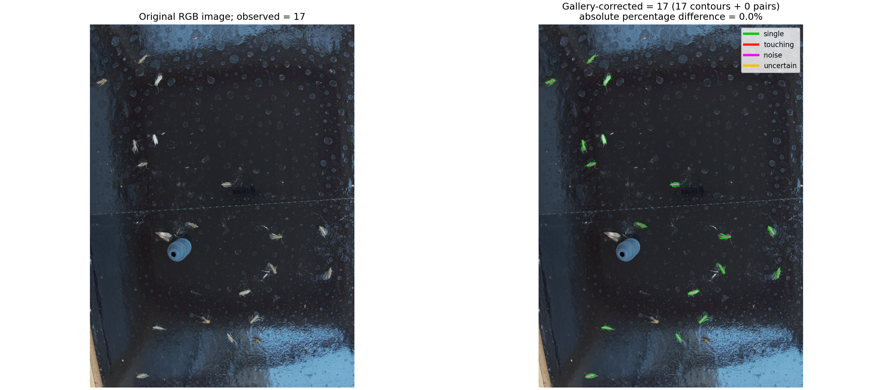
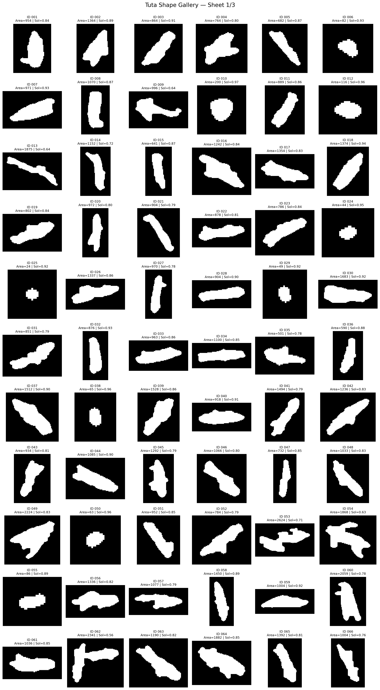

# AdapGreenAI · Tuta absoluta counting

**A research workflow for count-guided analysis of RGB adhesive pheromone-trap photographs.**

> **This implementation performs count-guided calibration. Because it uses the observed captures to optimize filtering thresholds for each image, the resulting counting error is not an independent measure of predictive accuracy.** A manually observed abundance is required for the documented workflow. This version does not independently predict abundance in photographs with unknown counts.



*Supplied demonstration: the original photograph has 17 manually observed moths; the overlay reports 17 retained contours and zero touching-pair additions. Colors identify single (green), touching (red), noise (magenta), and uncertain (orange) contours. This supplied illustration is not a held-out validation result; see the execution results below for the tested configuration.*

## Overview

*Tuta absoluta* (tomato leafminer) is a pest of tomato crops. Pheromone traps support monitoring of adult captures, but inspecting and counting trap photographs can require substantial manual effort. Developed within **AdapGreenAI**, this Python workflow explores image segmentation and silhouette matching as components of improved pest-monitoring technologies.

The software combines an RGB spectral feature, a weighted local spatial score, K-means segmentation, morphological cleanup, count-guided contour filtering, and gallery-based touching-pair correction. It is intended for researchers, collaborators, and students studying automated insect monitoring and precision agriculture. It is research-stage software; neither independent predictive performance nor operational readiness is established here.

## Algorithm overview

1. Load the photograph as RGB and normalize channel values to [0, 1], retaining the original-resolution RGB array for overlays.
2. Compute a red-balanced spectral feature. With ε = 10⁻⁶, the implemented feature is:

   `f = R × clip(R / ((G+B)/2 + ε), 0, 1)^3 × (min(R,G,B)/(max(R,G,B)+ε))`.

3. Multiply the center feature by the normalized Gaussian-weighted average of neighboring features: `S(p) = f(p) × Σq w(p,q)f(q)`. The 15 × 15 neighborhood excludes its center; Gaussian widths are σx = 6 and σy = 2, with radius 7. Scores for pixels with mean RGB below 50/255 become zero; the seven-pixel border is undefined and excluded from clustering. **This is a weighted local-neighborhood calculation, not graph-theoretical shortest-path closeness centrality.**
4. Fit two-cluster K-means to all finite scores (`n_init=10`, seed 42); the higher-centroid cluster is foreground. No pixel subsampling is used in the documented runs.
5. Apply 7 × 7 rectangular closing and 7 × 7 elliptical opening.
6. Extract external contours and measure area and solidity (area divided by convex-hull area).
7. Optimize minimum area, maximum area, and minimum solidity against the observed manual count (`a_t`, exposed as `observed_count` in Python and `--observed` in the CLI).
8. Compare retained contours with the labeled silhouette galleries using OpenCV Hu-moment shape matching.
9. Label each retained contour `single`, `touching`, `noise`, or `uncertain`.
10. Calculate the final count as **retained contours + touching classifications**.
11. Export masks, figures, classification tables, parameters, and summaries.

### Calibration settings and objective

| Setting | Value |
|---|---|
| Filter mode | `optimize` |
| Optimizer count mode | `legacy_original` |
| Initial minimum / maximum area | 600 / 5500 pixels² |
| Initial minimum solidity | 0.43 |
| Minimum-area search bounds | 600–1000 pixels² |
| Maximum-area search bounds | 2500–5500 pixels² |
| Solidity search bounds | 0.43–0.75 |
| Allowed optimizer count difference | 5% of observed abundance |
| Random candidates / starts / refinements | 2000 / 6 / 3 |
| Random seed | 42 |

For retained areas `A`, let `m = median(A)`. The legacy optimization count is:

`Nobjective = len(A) + count(A > 2.5m) + 2 × count(A > 3.5m)`.

Thus a contour above 3.5 times the median contributes **four**, because both increments apply. This deliberately preserves the supplied original objective; it is not silently corrected to three. An empty selection gives zero.

If the baseline objective is already within 5%, the search stops at the baseline. Otherwise the supplied algorithm searches a uniform/empirical-quantile grid, random candidates, and local refinements. Within tolerance it favors removing fewer baseline contours, then smaller count error, then smaller normalized parameter changes. Outside tolerance it favors smaller count error first. Bounds only tighten the baseline filter, so rejected baseline contours cannot be reintroduced. The 5% criterion is a target, not a guaranteed result, and applies to the **internal objective**, not the final gallery-corrected abundance.

The legacy objective is never added to the gallery correction. Final abundance is independently calculated from the retained contour list after classification. Existing optional fixed/alternative-objective code paths remain for compatibility; they are not the defaults or the documented analysis protocol.

## Repository contents

```text
adapgreenai-tuta-counting/
├── README.md
├── LICENSE                         # permissions pending, not an MIT grant
├── requirements.txt
├── requirements-lock.txt           # exact tested environment
├── .gitignore
├── tuta_pipeline.py
├── Tuta_pipeline_walkthrough.ipynb
├── test_tuta_pipeline.py
├── candidates.csv
├── tuta_gallery/{single,touching,noise}/
├── examples/
│   ├── metadata.csv
│   └── photo_*cut.png               # three real photographs
└── docs/
    ├── images/{original_vs_classified,contact_sheet_01}.png
    ├── VALIDATION.md
    ├── CHANGES.md
    └── validation_results.json
```

## Installation

Use **Python 3.12** (the tested version). Install Python 3.12 with your operating system's package manager or the official Python distribution; on Linux, ensure its `venv` support is installed. The code uses Python 3.10+ syntax, but other versions have not been validated here.

Clone the private repository using a GitHub account with access:

```bash
git clone https://github.com/jmrmcode/adapgreenai-tuta-counting.git
cd adapgreenai-tuta-counting
python3.12 -m venv .venv
source .venv/bin/activate
python -m pip install -r requirements.txt
python -m pip check
python -m pytest -q
jupyter lab Tuta_pipeline_walkthrough.ipynb
```

For the exact versions used in the recorded validation, install `requirements-lock.txt` instead of `requirements.txt` in a fresh environment. The lock file records the tested Linux/Python 3.12 environment; it is not a cross-platform compatibility guarantee.

On Windows, use `py -3.12 -m venv .venv` and `.venv\Scripts\Activate.ps1` in PowerShell; clone the actual repository URL directly. The remaining Python commands are the same. After cloning, analysis commands assume execution from the repository root. Headless Linux systems using `opencv-python` may need their distribution's OpenGL runtime if importing `cv2` reports a missing `libGL.so.1`.

## Quick start

The CLI and Python configuration both default to `optimize` and `legacy_original`; the commands make that choice explicit for reproducibility.

```bash
python tuta_pipeline.py \
  --image examples/photo_01_05_2026_12-01-01cut.png \
  --gallery-dir tuta_gallery \
  --observed 17 \
  --filter-mode optimize \
  --optimizer-count-mode legacy_original \
  --output-dir outputs/photo_01
```

```python
from pathlib import Path
from tuta_pipeline import Config, run_pipeline

config = Config(filter_mode="optimize", optimizer_count_mode="legacy_original")
summary = run_pipeline(
    image_path=Path("examples/photo_01_05_2026_12-01-01cut.png"),
    gallery_dir=Path("tuta_gallery"),
    output_dir=Path("outputs/python_example"),
    cfg=config,
    observed_count=17,
)
print(summary["estimated_tuta"])
```

Run all supplied examples with their recorded manual counts:

```python
from pathlib import Path
import pandas as pd
from tuta_pipeline import Config, run_pipeline

for row in pd.read_csv("examples/metadata.csv").itertuples(index=False):
    run_pipeline(Path("examples") / row.filename, Path("tuta_gallery"),
                 Path("outputs") / Path(row.filename).stem,
                 Config(), observed_count=int(row.observed_count))
```

`python tuta_pipeline.py --help` lists implemented options. Full-resolution processing fits K-means to several million pixels and requires appreciable memory. The optional `--kmeans-fit-max-pixels` changes the fit and is not used in the reference results.

## Example photographs

The final supplied scope is **three**, rather than five, real trap photographs. No photographs or manual counts have been invented. Original filenames, resolution, and decoded RGB pixel values are preserved. The photographs were losslessly re-encoded as PNG to remove ancillary metadata, including EXIF/GPS information.

| Photograph | Observed manual count | Dimensions (width × height) |
|---|---:|---:|
| `photo_01_05_2026_12-01-01cut.png` | 17 | 2128 × 2928 |
| `photo_20_05_2026_12-01-01cut.png` | 201 | 2183 × 2963 |
| `photo_21_04_2026_17-01-01cut.png` | 66 | 2247 × 2733 |

Counts were explicitly supplied by the project contributor for these filenames; they were not independently recounted during repository preparation. [examples/metadata.csv](examples/metadata.csv) is the common source for notebook selection and batch execution. Filenames are identifiers, not independently verified acquisition records.

## Working with the notebook

Open [Tuta_pipeline_walkthrough.ipynb](Tuta_pipeline_walkthrough.ipynb) from the repository root and use **Restart Kernel and Run All Cells**. The notebook imports the implementation instead of maintaining a separate algorithm. Select `IMAGE_NAME` in the first code cell; the corresponding observed abundance is loaded from `examples/metadata.csv`.

Cells expose normalized RGB preprocessing, connectivity maps, K-means foreground, morphological masks, external contours, selected filtering thresholds and optimization history, gallery classifications, and the corrected abundance. Exports go to `outputs/notebook/`; changing the selected image overwrites those outputs unless you change `OUTPUT_DIR`. Notebook outputs are cleared in version control to avoid stale results and large embedded images.

The notebook exports the four intermediate/overlay PNGs, classification CSV, filtering history, settings, and a compact summary without repeating segmentation. The CLI exports the complete set described below, including the two additional figures and expanded summary.

## Reference silhouette galleries

| Directory | Role | Supplied PNGs |
|---|---|---:|
| `tuta_gallery/single/` | Individual moth silhouettes | 159 |
| `tuta_gallery/touching/` | Touching or overlapping moth silhouettes, treated as pairs | 18 |
| `tuta_gallery/noise/` | Non-target shapes or segmentation artifacts | 32 |



*Supplied sheet 1 of 3 shows candidate IDs, areas, and solidity values. It is an illustrative subset, not the entire current gallery or evidence of classification accuracy. IDs correspond to candidate records where present.*

Each PNG should contain one connected white silhouette on a black background. The loader thresholds at 127, adds a two-pixel black border, and keeps references containing exactly one external contour of at least five pixels². Files are read in sorted order. Single and touching galleries must both be nonempty.

Matching uses `cv2.matchShapes(..., cv2.CONTOURS_MATCH_I2, 0.0)`, which compares Hu-moment shape descriptors. Each class receives the mean of its three smallest finite distances (or all available distances if fewer than three). The smallest score wins. The relative margin is `(second_best − best) / max(second_best, 1e-12)`; a margin below 0.001, or nonfinite competing scores, gives `uncertain`. These distances and margins are **not calibrated probabilities**.

**Counting policy:** every retained contour contributes one, including `noise` and `uncertain`. A `touching` classification contributes two. Gallery labels never remove retained contours. This unusual policy is preserved from the supplied implementation and can retain false positives. Larger aggregations are not explicitly resolved beyond a pair.

To expand the gallery, inspect real segmented candidates, manually label their single connected binary silhouettes, and save PNGs under the appropriate directory with unique filenames within that directory. Preserve a record of image provenance, annotation decisions, and permissions. Rerun gallery loading and inspect warnings; changing reference composition can change classifications and final counts. Keep independent evaluation photographs separate from gallery construction.

### `candidates.csv` data dictionary

The supplied table contains **209 records and 13 columns**, with a matching `(label, filename)` gallery PNG for each record. It is reference annotation metadata, not per-image observed counts, and is not read automatically by the counting pipeline. Its comma-delimited fields use quoted **decimal commas**; load it with `pd.read_csv("candidates.csv", decimal=",")`.

| Column | Meaning |
|---|---|
| `id` | Candidate identifier, linking to the silhouette filename/contact-sheet ID |
| `filename` | PNG basename; combine with `tuta_gallery/<label>/` |
| `area` | Recorded contour area in source-image pixels² |
| `solidity` | Recorded contour area / convex-hull area, dimensionless |
| `bbox_x`, `bbox_y` | Recorded bounding-box origin in source-image pixel coordinates |
| `bbox_w`, `bbox_h` | Recorded bounding-box width and height in pixels |
| `crop_x0`, `crop_y0` | Recorded crop origin in source-image pixel coordinates |
| `crop_x1`, `crop_y1` | Recorded crop end coordinates; their differences from the origins match supplied PNG dimensions |
| `label` | Manual reference category: `single`, `touching`, or `noise` |

Coordinates use the usual image convention (x rightward, y downward). The source image identifier and original extraction script were not supplied with this table, so source-image provenance and the exact crop-generation procedure cannot be independently reconstructed from these columns alone. Recorded metrics are preserved rather than recalculated from cropped PNGs.

## Output files and interpretation

| CLI output | Contents |
|---|---|
| `01_kmeans_foreground.png` | Binary higher-centroid cluster mask |
| `02_morphological_mask.png` | Mask after closing and opening |
| `03_size_solidity_mask.png` | Filled retained contours after optimized filtering |
| `04_classified_overlay.png` | Full-resolution RGB classification overlay |
| `05_original_vs_classified.png` | Original/overlay comparison with observed and corrected counts |
| `06_connectivity.png` | Spatial score visualization with color scale |
| `contour_classification.csv` | Retained/source contour IDs, geometry, class distances, best reference, margin, classification, and count contribution |
| `filter_history.csv` | Best parameters, objective count/error, and evaluation count at recorded search stages |
| `settings.json` | Full configuration, including search bounds and seed |
| `summary.json` | Observed count, internal objective, selected thresholds, class totals, final estimate, count differences, and runtime |

The `estimated_tuta` field is the final gallery-corrected abundance. `optimizer_objective_count_not_final` is a separate area-weighted calibration quantity. `absolute_percentage_difference` compares the final result to the same observed abundance used for calibration; it must not be reported as independent accuracy. A good optimizer match does not guarantee a good final match. CLI summaries include resolved local input paths for traceability; review those paths before distributing generated outputs. Generated outputs and environments are ignored by Git.

## Validation and reproducibility

See [docs/VALIDATION.md](docs/VALIDATION.md) for installation, unit tests, fresh-kernel notebook execution, and full-resolution CLI/notebook comparisons for all three photographs. Machine-readable results are in [docs/validation_results.json](docs/validation_results.json). These are software execution and consistency checks, not a scientific validation study.

## Methodological limitations and future development

- **Count dependence:** threshold selection requires the manually observed abundance of each analyzed image. Same-image calibration differences cannot quantify generalization.
- **Independent deployment:** a future deployment workflow requires calibration on separate data and independent evaluation with no access to test-image counts. That workflow is outside this repository's scope.
- **Image scale and acquisition:** area thresholds are in pixels² and morphology uses fixed pixel kernels. Resolution, crop scale, camera distance, trap dimensions, illumination, reflections, and background condition can affect results. Do not resize inputs without assessing these effects.
- **Shape specificity:** Hu-moment similarity does not establish species identity; other insects and artifacts may have similar silhouettes. Noise and uncertain detections remain counted by design.
- **Overlap:** touching classifications receive a two-individual contribution irrespective of the actual number in an aggregation. Filters may remove overlapping insects before classification.
- **Reference representativeness:** gallery composition and annotation quality influence results. Relevant imaging conditions, moth poses, debris, and overlaps should be represented and provenance recorded.
- **Optimization limits:** tuning can only remove baseline contours, so missed segmentation cannot be recovered by relaxing thresholds. The optimizer's area objective and final gallery rule may disagree.

## Funding

This workflow was supplied as work developed within the **AdapGreenAI research project** (PID2023-148677OA-I00) funded through the *Generación de Conocimiento 2023* call by the Spanish Ministry of Science, Innovation and Universities (MICIU) and the Spanish State Research Agency (AEI).

The project was funded by **MICIU/AEI/10.13039/501100011033** and co-funded by the **FEDER and EU**.

<p align="center">
  
</p>

## License

The source code of **AdapGreenAI – Tuta absoluta counting** is distributed under the **GNU General Public License, version 3.0 (GPL-3.0)**.

You are free to use, study, modify, and redistribute the software, including for commercial purposes, provided that you comply with the terms of the GPL-3.0 license. In particular, modified versions distributed to third parties must comply with the applicable source-code disclosure and licensing requirements.

The software is provided **without warranty**, including any implied warranty of merchantability or fitness for a particular purpose.

See the [LICENSE](LICENSE) file for the complete license terms.

**Data and image attribution:** The GPL-3.0 license applies to the source code. The example trap photographs, reference silhouette galleries, `candidates.csv`, and illustrative figures are not automatically covered by this license. Their reuse and redistribution may be subject to separate permissions or licensing conditions.

**Scientific attribution:** If you use this software in academic research, please cite the repository following the instructions provided in [CITATION.cff](CITATION.cff), when available.
